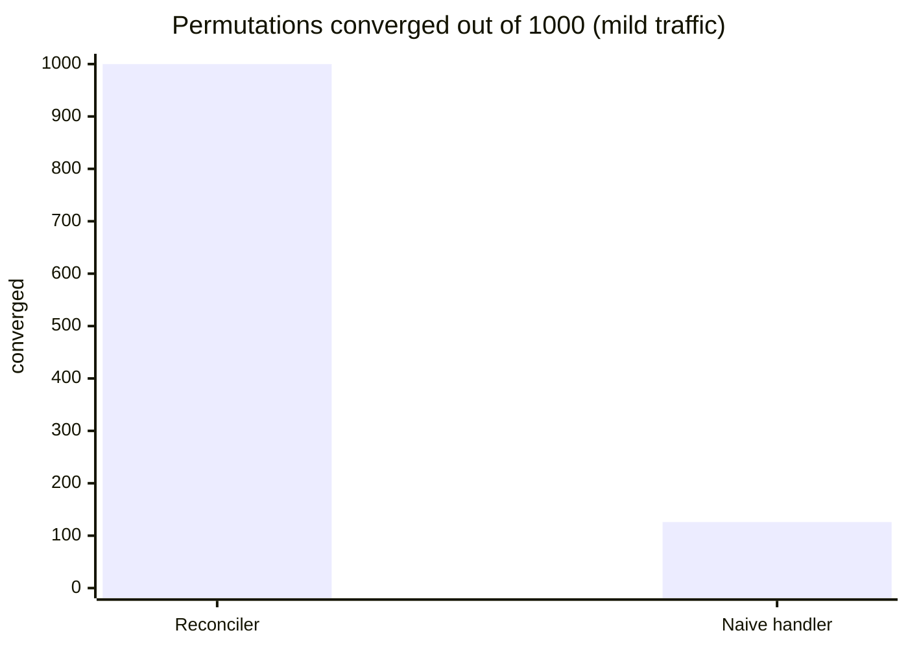
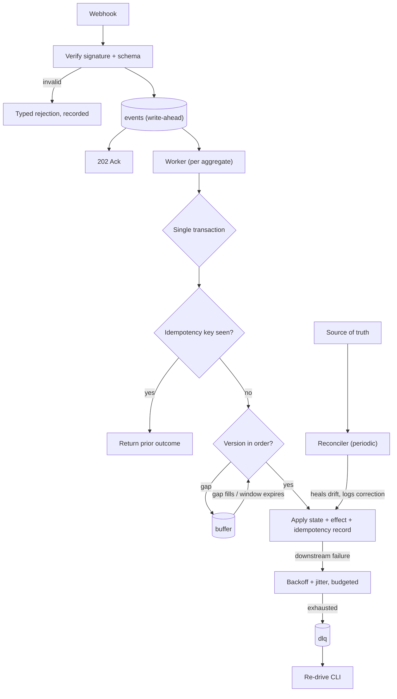

# Idempotent Webhook Reconciler

Webhooks arrive twice, out of order, late, corrupted or never; this service turns that into **exactly-once effects
with zero drift against the sender**, and a chaos harness proves it instead of claiming it.

> **Metric (written before the first commit).**
> *Before:* a naive webhook handler, run against the same chaos streams, produces duplicate effects and diverged state.
> *After:* 100 % of 1 000 generated delivery permutations converge to the state of a perfect in-order, exactly-once
> delivery; 0 duplicate effects under replay.
> **Result: met.** 1 000 / 1 000 converged, 0 duplicate effects. The naive handler was wrong on 1 000 / 1 000.

## Results

All numbers are produced by scripts in [`bench/`](bench/) and committed under [`bench/results/`](bench/results/).
Machine: Windows 11, 16 logical CPUs, Python 3.12.15, embedded PostgreSQL 16.2 (`bench/results/throughput_env.json`).

| 1 000 seeded chaos permutations | Reconciler | Naive handler |
|---|---:|---:|
| **Hostile** traffic (15 % drop, 30 % duplicate, 15 % corrupt, heavy reordering, 10 % sink failures): converged | **1 000** | 0 |
| **Mild** traffic (2 % drop, 10 % duplicate, 2 % corrupt, light reordering): converged | **1 000** | 126 |
| Duplicate effects (hostile) | **0** | 3 124 |
| Aggregates drifted, found by an *independent audit* before reconciling | 1 968 | – |
| …corrected by the reconciler | **1 968** | – |



| Other success metrics | Measured | Target |
|---|---:|---:|
| HTTP ack latency p50 / p95 / p99 | 2.1 / 2.6 / 2.9 ms | p95 < 50 ms |
| Processing throughput, 1 / 2 / 4 / 8 workers | 259 / 512 / 579 / 532 events/s | 50 sustained, 500 burst |
| DLQ time-to-resolution using the runbook alone (3 drills) | 5.7 s · 3.1 s · 2.5 s | – |
| Time from first commit to tagged v1 | 2 calendar days (19–20 Oct 2026) | ≤ 3 weeks |
| Tests / coverage | 178 tests, 97 % (gate 90 %) | – |
| Mutation score (pure decision modules) | 181 / 182 killed = **99.5 %** (first run 81.5 %) | ≥ 90 % |
| Where a worker's time goes (py-spy, incl. idle) | 93.4 % psycopg driver, 5.2 % our code | Rust criterion: > 30 % ours |

Throughput is single-node, in-process threads, embedded Postgres: evidence for the NFR table in
[`docs/hld.md`](docs/hld.md), not a capacity promise. "Naive fails" is per *permutation* (a stream of ~15 events), not
per event. The flamegraph is [`bench/results/flamegraph.svg`](bench/results/flamegraph.svg).

## What it does

* **Ingestion** — HMAC-verified, envelope-validated, persisted *before* the `202`. Every rejection is typed
  (`401/400/422`) and recorded; nothing is silently dropped.
* **Idempotency** — the state change, an `effect_log` row and the idempotency record commit in one transaction. A
  replay observes the completed record (or an already-covered version) and does nothing.
* **Ordering** — dense per-aggregate versions; gaps are buffered for a bounded window, then parked-and-alerted (or
  last-writer-wins, by policy).
* **Retries & failure** — budgeted exponential backoff with full jitter; terminal errors and exhausted budgets go to an
  *operated* DLQ (list / redrive / discard, alert on depth). A poison message stalls one aggregate, not the stream.
* **Reconciliation** — a periodic pass heals drift against the source's list endpoint and logs every correction.
* **Observability** — JSON logs, W3C trace context stored on the event so every attempt (and re-drive) joins the
  original webhook's trace, `stats` / `alerts` read models.
* **Reusable pattern library** — [`reconciler.patterns`](src/reconciler/patterns/) (ordering, retry, idempotency, DLQ)
  has no framework imports so P3, P7 and P8 import it instead of re-inventing it.

## Architecture



Design: [`docs/hld.md`](docs/hld.md) (one page + architect's review memo) · contracts, schemas, sequences, invariants:
[`docs/lld.md`](docs/lld.md) / [`docs/openapi.json`](docs/openapi.json) · decisions: [`docs/adr/`](docs/adr/) (6 ADRs) ·
[`docs/mutation.md`](docs/mutation.md) · [`docs/interview.md`](docs/interview.md).

## Quickstart

```bash
git clone https://github.com/debarshi29/concord && cd concord
make dev      # uv sync --frozen + git hooks
make test     # 178 tests against a real (embedded) Postgres, coverage gate 90 %
make run      # embedded Postgres + API on :8000 + worker; docs at /docs (secret: dev-secret)
```

Prerequisite: [`uv`](https://docs.astral.sh/uv/). No Docker or Postgres install is needed for tests (ADR-0006). Without
`make` (e.g. plain Windows) the equivalent is `uv sync --frozen && uv run pytest --cov`. With Docker: `make up`
(Postgres + migrate + API + worker).

Try it (with `make run` going):

```python
import hashlib, hmac, json, httpx

body = json.dumps(
    {"type": "order.updated", "aggregate_id": "o1", "version": 1, "data": {"status": "paid"}}
).encode()
sig = "sha256=" + hmac.new(b"dev-secret", body, hashlib.sha256).hexdigest()
r = httpx.post("http://127.0.0.1:8000/webhooks", content=body, headers={"X-Signature": sig})
print(r.status_code, r.json())  # 202 {...}; send it again: still one effect
print(httpx.get("http://127.0.0.1:8000/stats").json()["events_by_status"])
```

## Benchmarks

| Command | Produces | Methodology |
|---|---|---|
| `make chaos` | `bench/results/chaos*.csv`, `chaos_summary*.json` | 1 000 seeds × (reconciler, naive) × 2 profiles; fully reproducible from the seed range |
| `make bench` | `throughput.csv` | ack latency over real HTTP (1 000 sequential requests after 50 warm-up); events/s with 1–8 workers over 100 aggregates |
| py-spy → `bench.profile_summary` | `flamegraph.svg`, `profile_summary.txt` | `--idle` so time blocked on Postgres is counted |
| `make mutate` | `mutation.csv`, `mutation_survivors.txt` | run in a clean worktree: cosmic-ray edits files in place |

## Failure modes and runbook

[`docs/runbook.md`](docs/runbook.md) — symptom → scope → fix → verify, executed through the CLI by e2e drills:

| Situation | Drilled | Resolution |
|---|---|---|
| Downstream outage → DLQ | yes | 5.7 s |
| Poison message | yes | 3.1 s |
| Version gap never fills (parked events) | yes | 2.5 s |
| Worker killed mid-transaction | yes | nothing half-applied, finishes on another worker |
| Database failover, PITR restore | **no** | listed as a known gap |

## What it is deliberately bad at

* **Latency of convergence after a lost event** — up to the gap window (5 min) plus the reconcile interval (15 min).
* **External side effects** — the sink runs inside the transaction, so a real external call is at-least-once.
* **A very hot aggregate** — per-aggregate serialisation caps one aggregate near a single worker's throughput.
* **Cross-aggregate invariants** — ordering is per aggregate only.
* **Ops endpoints are unauthenticated** (`/stats`, `/alerts`); bind them to an internal network.
* **No replay-attack window** — signatures cover the body, not a timestamp.
* **`events` grows unbounded** — no partitioning/retention in v1 (≈ 10 GB/day at 50 ev/s if every duplicate is kept).
* **Throughput** — a single Postgres primary; ~580 events/s measured on a laptop.

## Extensions (not built)

Transactional **outbox** (exactly-once outbound) · multi-source reconciliation with conflict policies · versioned event
schemas with compatibility checks in CI · using the pattern library as the action-delivery substrate for the agent
sandbox (P8) · `events` partitioning and retention · nightly mutation testing of `processor.py` · auth and
timestamp-window replay protection.

## Definition of Done

- [x] README leads with a measured result
- [x] Clone test passes on a clean checkout (`uv sync --frozen && uv run pytest`; CI runs the same on Ubuntu)
- [x] CI green with coverage (97 %) and a recorded mutation run (99.5 %)
- [x] HLD, review memo, 6 ADRs, LLD contracts and runbook exist
- [x] Deliberate incidents exercised (3 drills + crash) and runbook entries validated
- [x] Release tag `v1.0.0`
- [x] "Deliberately bad at" section written
- [x] Interview questions and answers: [`docs/interview.md`](docs/interview.md) *(added to the standard for every project)*

## Repository map

`src/reconciler/` service · `src/reconciler/patterns/` reusable pattern library · `src/reconciler/chaos/` harness ·
`tests/{unit,integration,property,e2e}/` · `bench/` benchmarks + results · `docs/` design, runbook, interview Q&A ·
`.github/workflows/` CI + release.
