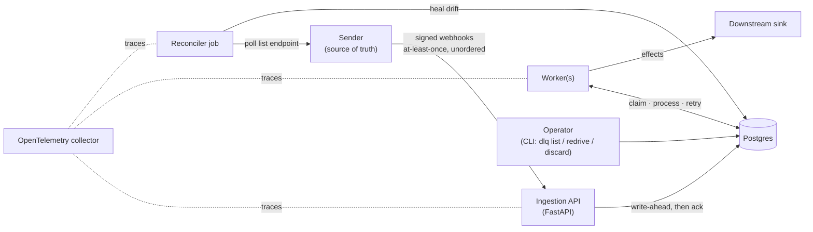

# HLD — Idempotent Webhook Reconciler

One page of architecture, followed by the architect's review memo (time-boxed to half a day).
Decisions live in [`adr/`](adr/); contracts, schemas and sequences live in [`lld.md`](lld.md).

## 1. Context

A sender (a payment/ERP/e-commerce system) POSTs signed webhooks describing changes to *aggregates*
(orders). Delivery is at-least-once and unordered. The reconciler must make its own copy of each
aggregate converge to the sender's, applying every change **effectively once**, and must keep working
when a downstream dependency is down or one event is poison.

## 2. Components and responsibilities

| Component | Responsibility | Does **not** do |
|---|---|---|
| Ingestion API | verify signature, validate envelope, extract idempotency key, persist to `events` *before* ack, typed rejections | any business processing |
| Worker | claim a `received` event, run the single processing transaction, schedule retries, route to DLQ | trust arrival order |
| Pattern library (`reconciler.patterns`) | `ordering.decide`, `RetryPolicy`, idempotency store, DLQ ops — imported by P3/P7/P8 | know about orders |
| Domain (`reconciler.domain`) | validate + apply an `order.updated` patch | touch the DB |
| Reconciler | compare local aggregates to the source's list endpoint, heal drift, log every correction | run on the hot path |
| Chaos harness (`reconciler.chaos`) | deliver duplicated/reordered/delayed/dropped/corrupted events; assert convergence | ship in the request path |

## 3. Data flow

1. **Ingest.** Verify HMAC → parse envelope → derive key → `INSERT INTO events` → commit → `202`.
   Invalid events are inserted with `status='rejected'` and a typed reason, and answered `401/422`.
2. **Process** (one transaction, `FOR UPDATE SKIP LOCKED` claim, aggregate row lock):
   idempotency lookup → version decision (apply / buffer / stale) → state change + `effect_log` +
   idempotency record → drain any buffered successors.
3. **Fail.** Retryable error → savepoint rolled back, `attempts+1`, `next_attempt_at = now + backoff(jitter)`.
   Terminal error or budget exhausted → `dlq` row + alert condition.
4. **Reconcile.** Every `reconcile_interval`, page the source, and for each aggregate whose local
   `(version, state)` differs, overwrite from the source and write a `corrections` row.

## 4. Key decisions (full ADRs in `adr/`)

* **ADR-0001** idempotency records live 7 days; the per-aggregate version check is the backstop at the edge.
* **ADR-0002** a gap in versions is buffered for 5 minutes, then *parked and alerted*; the reconciler heals it.
  Last-writer-wins by version is available as a policy for liveness-over-fidelity domains.
* **ADR-0003** ordering is per aggregate (row lock), never global — one bad event blocks one aggregate.
* **ADR-0004** Postgres is the queue, the ledger and the state store for v1.
* **ADR-0005** Python + hand-written SQL (psycopg3); Rust was considered and rejected.
* **ADR-0006** tests run against a real (embedded) Postgres, not mocks.

## 5. Review memo (architect's lens, half-day time-box)

### 5.1 NFRs (numbers)

These are the *design targets*; measured values are in the README and `bench/results/`.

| Dimension | Target |
|---|---|
| Sustained load | 50 events/s, burst 500 events/s for 60 s |
| Growth | 2× per year; 5 M events/day ceiling for the single-node design |
| Ingestion ack latency | p50 < 10 ms, p95 < 50 ms, p99 < 150 ms |
| Processing lag (receive → effect) | p95 < 2 s healthy |
| Availability (ingestion) | 99.9 % monthly |
| RPO / RTO | RPO 0 for acked events (synchronous commit); RTO 15 min (restart + PITR) |
| Consistency | per-aggregate sequential; replica ≡ source within one reconcile interval (default 15 min) |
| Correctness | duplicate effects = 0; chaos convergence = 100 % |

**Measured (v1.1.0, developer laptop, embedded Postgres 16 — `bench/results/`)**

| Dimension | Target | Measured |
|---|---|---|
| Ingestion ack latency p50 / p95 / p99 | 10 / 50 / 150 ms | 1.6 / 2.4 / 3.0 ms (sequential, real HTTP) |
| Sustained / burst processing | 50 / 500 events/s | 314 events/s on 1 worker; 547 / 552 / 512 on 2 / 4 / 8 |
| Chaos convergence | 100 % | 1 000 / 1 000 hostile, 1 000 / 1 000 mild |
| Duplicate effects | 0 | 0 |

The latency measurement is a single sequential client, so it says nothing about tail behaviour under concurrent
load. The throughput plateau beyond 2 workers is round-trip bound, not CPU bound in our code: the profile puts
93 % of time in the psycopg driver and 5 % in our own code (`bench/results/profile_summary.txt`, ADR-0005).

### 5.2 Envelope

* Row size ≈ 1 KB (raw body + payload jsonb + indexes ≈ 2.5 KB). At 50 ev/s: 4.3 M rows/day ≈ **~10 GB/day**
  with indexes if every duplicate is retained → `events` needs a 30-day retention job and time partitioning
  beyond ~1 M events/day (v1.1 ships the retention job, `RETENTION_SECONDS`; partitioning remains an extension).
* Idempotency table: one row per applied event, ~150 B; 7 days × 4.3 M ≈ 30 M rows ≈ 4.5 GB worst case.
* Workers: processing is a few round-trips; **measured ≈ 310 ev/s per worker** (the estimate made before building
  was 100–200). Peak 500 ev/s ⇒ 2–3 workers; average load needs 1.
* **Scale ceiling**: single Postgres primary ≈ low thousands of events/s. Next design: partition `events`
  by `hash(aggregate_id)`, one claim loop per partition, or move the WAL to a log broker (ADR-0004 revisit).

### 5.3 Failure-mode table

| Component | Failure | Detection | Impact | Mitigation | Paged |
|---|---|---|---|---|---|
| Ingestion API | crash after ack | none needed (write-ahead) | none — event is durable | WAL before ack | no |
| Ingestion API | crash before commit | sender sees timeout/5xx | sender retries | idempotency key | no |
| Postgres | primary down | `/readyz` fails, 5xx rate | ingestion & processing stop; senders retry | managed HA, RTO 15 min | yes |
| Worker | crash mid-transaction | tx rolls back; lock released | event re-claimed | single-tx processing | no |
| Downstream sink | outage | retry-rate + `dlq_depth` alert | events retry then DLQ | backoff+jitter, bounded budget | on DLQ alert |
| Poison event | handler raises terminal error | DLQ alert | **one aggregate** stalls (ADR-0003) | DLQ, `dlq discard` + reconcile | on DLQ alert |
| Sender | event never delivered | reconciler correction count | replica drifts | reconciler heals | no (trend alert) |
| Sender | version gap that never fills | `parked_events` alert | aggregate stalls | reconciler heals, drains buffer | on parked alert |
| Reconciler | source list endpoint down | job error log, `last_reconcile_age` alert | drift persists | retry next interval | on age alert |
| Ingestion API | flood of unsigned or oversized bodies | `413` rate, `rejected` row count | memory and disk pressure | body cap (1 MiB, refused unread), rejections stored truncated and purged after 7 days | no |
| Migrator | two replicas start together | none needed | would double-run a migration | advisory lock held until the migration commits; each migration is its own transaction | no |
| Worker | reconcile source slow or hung | `reconcile_stale` alert | drift persists; processing unaffected | reconcile runs on its own thread, bounded by the source's HTTP timeout | on age alert |
| Postgres | tables grow without bound | storage alerts of the platform | disk fills | `RETENTION_SECONDS` sweep (30 days) in bounded batches | platform |
| Clock skew | worker vs DB | n/a — all times come from the app clock passed into SQL | backoff drifts only | NTP | no |

### 5.4 Top three trade-offs (mini-ADRs)

1. **Postgres as queue.** Gains: one transaction covers claim, state change and idempotency record, so
   exactly-once *effects* need no 2PC. Costs: throughput ceiling and `events` bloat. Revisit at ~1 k ev/s.
2. **Park-and-alert on gaps.** Gains: never applies a change on top of missing history. Costs: an aggregate can
   stall until the reconciler runs (≤ 15 min). Chosen because the business cost of a wrong order state exceeds
   the cost of a delayed one.
3. **Hand-written SQL over an ORM.** Gains: the transaction boundaries and locks are visible in the code under
   review. Costs: more boilerplate, no migration autogeneration.

### 5.5 One-way doors

| Door | Protected by |
|---|---|
| `events`/`aggregates` schema | forward-only migrations, expand–migrate–contract; rollback story = PITR (runbook §9) |
| Idempotency key derivation (`header > event_id > content hash`) | ADR-0001; changing it would re-apply old events — guarded by the version check |
| Webhook signature scheme (HMAC-SHA256 over raw body) | secret rotation supported via `webhook_secret_previous` |

### 5.6 Security / tenancy

Single tenant. The only trust boundary is the webhook: HMAC-SHA256 over the raw body, constant-time compare,
rejected events are stored (for forensics) but never processed; bodies over 1 MiB are refused unread, and
unauthenticated rejections are stored truncated and purged after a week. Ops endpoints (`/stats`, `/alerts`) are
open unless `RECONCILER_OPS_TOKEN` is set (then bearer-gated); otherwise bind them to an internal network.
Proof: `tests/integration/test_ingest.py` (forged/missing signature never reaches `received`).

### 5.7 The 2 a.m. story

> 02:07 the ERP's billing sink starts timing out. Workers retry with backoff; by 02:19 the first events exhaust
> their 6-attempt budget and land in the DLQ. At depth ≥ 1 the `dlq_depth` alert pages on-call. The runbook says:
> run `reconciler stats` (confirm DLQ depth and that the other aggregates are still flowing — they are, because
> partitioning is per aggregate), check the sink, then `reconciler dlq redrive --all` once it is healthy.
> Drift introduced while events were stuck is closed by the next reconcile pass, whose corrections are logged.

Runbook entry: [`runbook.md` §3 "DLQ depth alert"](runbook.md), exercised by `tests/e2e/test_incident_drill.py`.

### 5.8 Deliberately deferred

Outbox for *outbound* publication, multi-source reconciliation, schema evolution/versioned event types,
`events` partitioning, multi-tenant isolation, per-user authentication on ops endpoints, replay-attack
protection (signed timestamp window). Each is listed in the README's *Extensions*.
