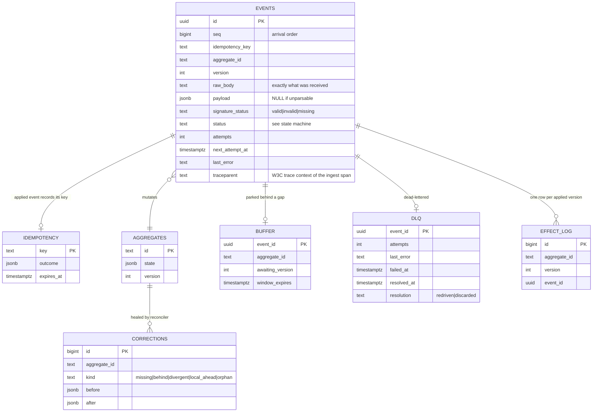
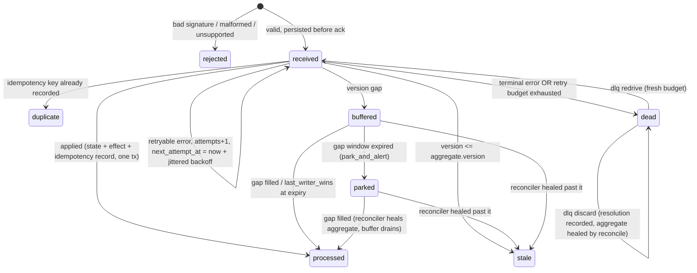
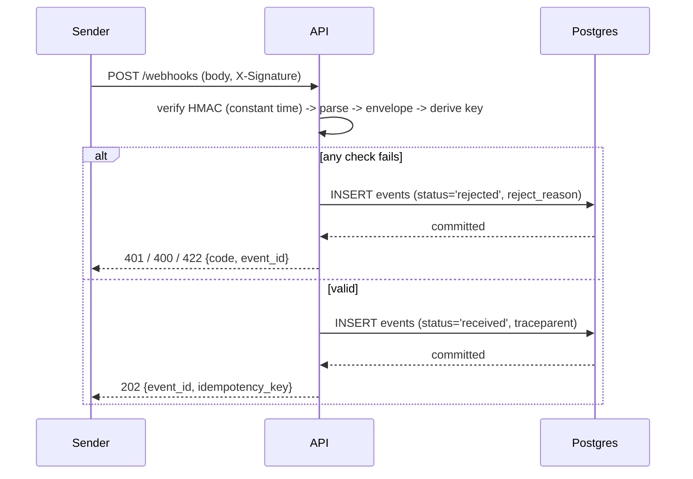
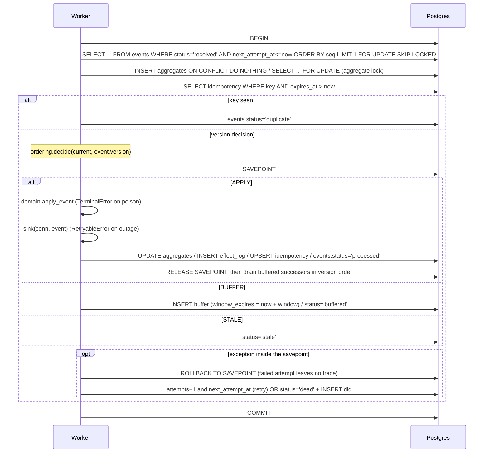
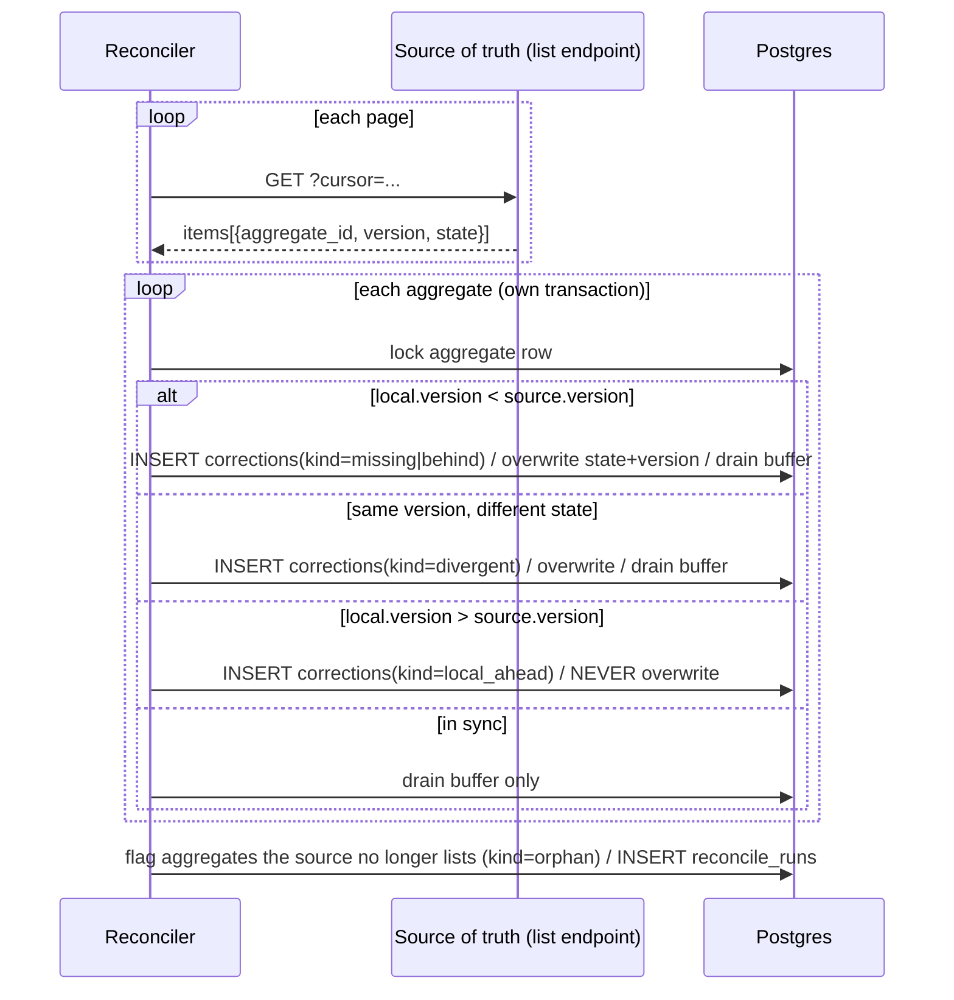

# LLD — contracts, schemas, sequences

Companion to [`hld.md`](hld.md). The HTTP contract is machine-readable in [`openapi.json`](openapi.json) and a
test (`tests/integration/test_openapi_contract.py`) fails if it drifts from the running app.

## 1. HTTP contract

`POST /webhooks` — headers: `X-Signature: sha256=<hex HMAC-SHA256 of the raw body>` (required),
`Idempotency-Key` (optional). Body: the envelope below.

| Status | `error.code` | Meaning | Recorded? | Sender should |
|---|---|---|---|---|
| 202 | – | durably stored; processing is asynchronous | `events.status='received'` | stop retrying |
| 401 | `missing_signature` | no `X-Signature` | yes, `rejected` | fix config |
| 401 | `invalid_signature` | HMAC mismatch (current or previous secret) | yes, `rejected` | fix secret / do not retry as-is |
| 400 | `malformed_json` | body is not JSON | yes, `rejected` | fix payload |
| 422 | `invalid_envelope` | envelope schema violated (`error.detail` lists fields) | yes, `rejected` | fix payload |
| 422 | `unsupported_event_type` | `type` is not `order.updated` | yes, `rejected` | stop sending |
| 413 | `payload_too_large` | body over `MAX_BODY_BYTES` | **no**: refused unread, so an anonymous flood cannot fill the table | send less |

Every error body is `{"error": {"code", "detail", "retryable": false, "event_id"}}`; `event_id` is the id of the
**recorded** event, so a rejected delivery can be found later. The ack (202) is sent only after the insert has
committed. Other endpoints: `GET /healthz` (liveness), `GET /readyz` (`SELECT 1`, 503 on failure),
`GET /stats`, `GET /alerts`.

### Envelope (boundary schema, `reconciler.models.Envelope`)

| Field | Type | Constraint |
|---|---|---|
| `event_id` | string, optional | 1–200 chars; the sender's id, used as idempotency key unless a header is given |
| `type` | string | must be in `SUPPORTED_EVENT_TYPES` (`order.updated`) |
| `aggregate_id` | string | 1–128 chars |
| `version` | integer (strict) | 1 … 2 000 000 000; dense and monotonic per aggregate |
| `data` | object | validated by the **domain handler**, not the boundary |
| `occurred_at` | datetime, optional | informational |

Boundary vs. domain validation is deliberate: a schema-valid event with business-invalid `data` (a *poison*
message) is accepted, stored and dead-lettered with full context rather than refused where nobody can inspect it.

### Domain patch (`reconciler.domain.OrderPatch`, `extra="forbid"`, strict)

`status ∈ {pending, paid, shipped, cancelled}`, `amount_cents ≥ 0`, `currency ~ ^[A-Z]{3}$`,
`customer_id ≤ 128 chars`. Only the keys **present** are applied (shallow merge). Violations raise `TerminalError`.

## 2. Data model

Schema source of truth: `src/reconciler/migrations/0001_init.sql` (forward-only; see runbook §9).
`effect_log` has **no unique constraint** on `(aggregate_id, version)` on purpose: the duplicate-effect metric is
`count(*) − count(distinct (aggregate_id, version))`, which must be a measurement, not an exception.

### Event status state machine

## 3. Sequences

### 3.1 Ingestion (persist, then ack)

### 3.2 Processing transaction (the heart of the project)

### 3.3 Reconciliation

## 4. Invariants (each is enforced by a named test)

| # | Invariant | Where it is proven |
|---|---|---|
| I1 | An acked event is durable | `test_valid_event_is_persisted_before_ack` |
| I2 | A rejected event is recorded, typed, and never processable | `test_bad_signatures_are_recorded_and_never_processable`, `test_malformed_events_get_a_typed_rejection_and_are_recorded` |
| I3 | Replaying any delivered event any number of times changes neither state nor effects | `test_replaying_any_delivered_event_any_number_of_times_changes_nothing` (Hypothesis) |
| I4 | A replay after the idempotency TTL is a no-op (version backstop) | `test_replay_after_ttl_is_noop` |
| I5 | Nothing is applied on top of missing history under `park_and_alert` | `test_gap_window_expiry_parks_and_alerts_under_default_policy` |
| I6 | A failed attempt leaves no trace; retries are budgeted and jittered | `test_retryable_failure_rolls_back_and_schedules_backoff`, `test_backoff_ceiling_grows_and_is_budgeted` |
| I7 | A poison event blocks only its own aggregate | `test_poison_message_only_blocks_its_own_aggregate` |
| I8 | Exactly one effect per `(aggregate, version)` regardless of worker count | `test_shuffled_stream_with_duplicates_converges_under_concurrency` |
| I9 | After chaos + time + one reconcile pass, state equals perfect in-order exactly-once delivery | `test_chaos_converges_*`, `bench/chaos_run.py` (1000 permutations) |
| I10 | The chaos harness can fail | `tests/property/test_harness_sensitivity.py` |

## 5. Locking and isolation

Order of acquisition, in every code path: **event row** (`FOR UPDATE SKIP LOCKED`) → **aggregate row**
(`FOR UPDATE`) → **buffered event rows of that aggregate** (`FOR UPDATE OF e`). Workers only *claim* events with
status `received`; buffered/parked rows are touched only by whoever holds the aggregate lock, so there is no lock
cycle. Default isolation (read committed) is sufficient because every decision is made while holding the aggregate
row lock. The reconciler takes the same aggregate lock per aggregate, in its own short transaction.

## 6. Configuration (`RECONCILER_*`, validated at boot by `pydantic-settings`)

| Variable | Default | Meaning |
|---|---|---|
| `DATABASE_URL` | local postgres | connection string |
| `WEBHOOK_SECRET` / `WEBHOOK_SECRET_PREVIOUS` | – (required to serve) | HMAC secrets; previous accepted during rotation |
| `IDEMPOTENCY_TTL_SECONDS` | 604800 (7 d) | ADR-0001 |
| `BUFFER_WINDOW_SECONDS` | 300 | ADR-0002 |
| `GAP_POLICY` | `park_and_alert` | or `last_writer_wins` |
| `RETRY_BASE_SECONDS` / `RETRY_CAP_SECONDS` / `RETRY_MAX_ATTEMPTS` | 1 / 300 / 6 | backoff `U(0, min(cap, base·2^(n−1)))` |
| `WORKER_POLL_SECONDS` / `SWEEP_INTERVAL_SECONDS` | 0.5 / 15 | worker loop cadence |
| `RECONCILE_SOURCE_URL` / `RECONCILE_INTERVAL_SECONDS` | – / 900 | enables the reconciler job |
| `OPS_TOKEN` | – | when set, `/stats` and `/alerts` require `Authorization: Bearer <token>` |
| `MAX_BODY_BYTES` | 1048576 | larger bodies get 413 without being read or stored |
| `REJECTED_RETENTION_SECONDS` | 604800 | sweep deletes unauthenticated `rejected` rows older than this (bodies stored truncated to 2 KiB) |
| `RETENTION_SECONDS` | 2592000 | sweep deletes finished events, effect-log rows, corrections and resolved DLQ rows older than this, in batches of 5000 per table; `0` disables. Never deletes events still referenced by an idempotency record, an open DLQ entry or the buffer, nor the latest reconcile run |
| `ALERT_DLQ_DEPTH` / `ALERT_PARKED_EVENTS` / `ALERT_OLDEST_BUFFERED_SECONDS` / `ALERT_RECONCILE_AGE_SECONDS` | 1 / 1 / 900 / 3600 | alert thresholds |
| `OTEL_EXPORTER` | `none` | `console` or `otlp` (install the `otlp` extra) |
| `FAULT_DOWNSTREAM_OUTAGE_FILE` | – | fault injection for drills: sink fails while the file exists |

## 7. Error taxonomy (`reconciler.errors`)

`RetryableError` (server-side, transient → backoff, budgeted) · `TerminalError` (poison → DLQ immediately) ·
`IngestRejected` (client fault, typed `RejectCode`, never retried by us). Unexpected exceptions inside processing are
wrapped as retryable so they consume the budget instead of hot-looping. Each failure is logged **once**, in
`processor._fail` (or the worker-loop boundary), with `event_id`, `aggregate_id`, `attempts`, `error`.

## 8. Observability

* **Logs**: JSON on stderr, context in `extra` fields.
* **Traces**: the ingest span's `traceparent` is stored on the event row; every later `process_event` attempt
  (including after a DLQ re-drive) is a child span of the *original* webhook trace, with `outcome` and `attempt`
  attributes. `reconcile` spans carry `checked`/`corrected`.
* **Alerts** (`reconciler alerts`, exit 1 when any fires): `dlq_depth`, `parked_events`, `buffer_age`,
  `reconcile_stale`.
* **Metrics-as-SQL** (`reconciler stats`): `events_by_status`, `duplicate_effects`, `corrections_last_24h`
  (should trend to zero), `dlq_mean_time_to_resolution_s`.
